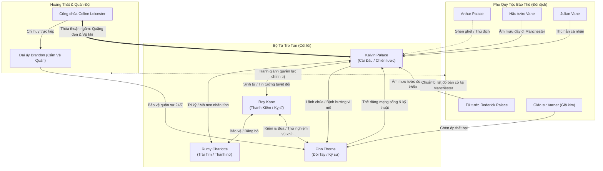

# DANH MỤC NHÂN VẬT & SƠ ĐỒ QUAN HỆ (CHARACTERS MASTER INDEX)

> **Dự án:** Biên Niên Sử Tro Tàn: Kalvin Palace  
> **Cập nhật lần cuối:** Sau Chương 28  
> **Cơ sở dữ liệu thẻ độc lập:** `/NovelProject/Characters/*.md`

---

## 1. BẢNG TỔNG HỢP DANH MỤC NHÂN VẬT

| Mã thẻ | Tên nhân vật | Thân phận / Vai trò | Phe phái | Mối quan hệ với Nam chính | Trạng thái hiện tại | Thẻ chi tiết |
|---|---|---|---|---|---|---|
| **CHR-001** | **Kalvin Palace** | Nhân vật chính / Cái Đầu | Nhóm Tro Tàn / Cấm Vệ | Bản thân | Đang ở Hoàng đô, chuẩn bị tiếp quản Manchester | [Xem thẻ](Characters/001_Kalvin_Palace.md) |
| **CHR-002** | **Rumy Charlotte** | Nữ chính / Trái Tim / Thánh Nữ | Nhóm Tro Tàn / Dược sư | Bạn tri kỷ / Mỏ neo nhân tính | Dược sư trưởng Xưởng Quân Nhu Số Ba | [Xem thẻ](Characters/002_Rumy_Charlotte.md) |
| **CHR-003** | **Roy Kane** | Nam thứ / Thanh Kiếm / Võ sĩ | Nhóm Tro Tàn / Tiên phong | Huynh đệ sinh tử / Kỵ sĩ trung thành | Võ sĩ Tam tinh, sở hữu Trọng Kiếm Sắt Đen | [Xem thẻ](Characters/003_Roy_Kane.md) |
| **CHR-004** | **Finn Thorne** | Kỹ sư ma đạo / Đôi Bàn Tay | Nhóm Tro Tàn / Thợ rèn | Thuộc hạ thề trung thành / Kỹ sư trưởng | Tổng công trình sư Xưởng Tầng Hầm Số Bảy | [Xem thẻ](Characters/004_Finn_Thorne.md) |
| **CHR-005** | **Celine Leicester** | Nhị Công chúa Vương quốc | Hoàng tộc / Cấm Vệ Quân | Đồng minh chính trị chiến lược | Bảo hộ nhóm Kalvin, cấp chìa khóa Tháp Chuông Đen | [Xem thẻ](Characters/005_Celine_Leicester.md) |
| **CHR-006** | **Elena** | Cựu hầu nữ / Mẹ Kalvin | Thường dân nhà Palace | Mẹ ruột | Đã qua đời (Chương 14), nguồn động lực sống | Đã lưu |
| **CHR-007** | **Tử tước Roderick** | Chủ gia tộc Palace | Quý tộc bảo thủ | Cha ruột / Kẻ ruồng bỏ | Cắt đứt quan hệ, đang âm mưu kéo Kalvin về | Đã lưu |
| **CHR-008** | **Cordelia Palace** | Phu nhân Tử tước Palace | Quý tộc bảo thủ | Mẹ kế độc ác | Kẻ đầu độc Elena, căm ghét Kalvin | Đã lưu |
| **CHR-009** | **Arthur Palace** | Con trai trưởng nhà Palace | Học viên viền vàng | Anh cùng cha khác mẹ / Kẻ thù | Thất bại ở Rừng Sương Muối, nằm liệt giường | Đã lưu |
| **CHR-010** | **Julian Vane** | Con cháu Hầu tước Vane | Phe cánh nhà Vane | Kẻ thù đối địch | Bẽ mặt tại Tầng Hầm Số Bảy, đe dọa trả thù | Đã lưu |
| **CHR-011** | **Đại úy Brandon** | Sĩ quan cao cấp Cấm Vệ | Cấm Vệ Quân (Phe Celine) | Người bảo hộ trực tiếp | Chỉ huy tiểu đội bảo vệ Tầng Hầm Số Bảy | Đã lưu |
| **CHR-012** | **Giáo sư Varner** | Viện trưởng Phân viện Giả kim | Tay chân nhà Vane | Kẻ áp bức thất bại | Bị Cấm Vệ Quân trục xuất khỏi Tầng Hầm Số Bảy | Đã lưu |

---

## 2. SƠ ĐỒ MẠNG LƯỚI QUAN HỆ (RELATIONSHIP GRAPH)

---

## 3. NGUYÊN TẮC QUẢN LÝ NHÂN VẬT BẮT BUỘC (§13 SKILL)

1. **Trước mỗi chương**: Bắt buộc đọc file `Characters/*.md` của các nhân vật sẽ xuất hiện để nắm chắc trạng thái, trang bị, tâm lý và hảo cảm hiện tại.
2. **Sau mỗi chương**: Cập nhật vùng 🔄 Thuộc tính biến động nếu có phát sinh (tuổi, quan hệ, chức vị, tài sản, thương tật, kỹ năng mới).
3. **Tuyệt đối không OOC**: Kalvin không kiêu ngạo; Roy không toan tính mưu mô; Rumy không yếu đuối ngây thơ; Finn không màng quyền quý.
