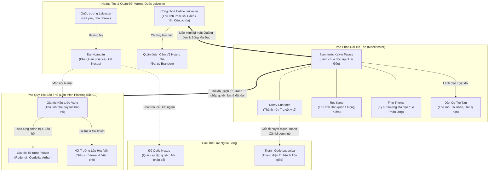

# THIẾT LẬP CÁC THẾ LỰC & CẤU TRÚC CHÍNH TRỊ (FACTIONS BIBLE)

> **Dự án:** Biên Niên Sử Tro Tàn: Kalvin Palace  
> **Cập nhật lần cuối:** Sau Chương 28  
> **Quy chuẩn:** Seinen Political & Faction Systems

---

## 1. BẢN ĐỒ CÁC THẾ LỰC CHÍNH

---

## 2. CHI TIẾT CÁC THẾ LỰC & ĐẶC TÍNH NỘI TẠI

### 2.1. Phe Pháo Đài Tro Tàn (Nhóm Kalvin / Manchester Core)
- **Tôn chỉ & Mục đích:** Xây dựng một trật tự mới dựa trên thực tài, kỹ thuật công nghiệp ma đạo và sự bình đẳng sinh tồn; thoát khỏi sự áp bức giai cấp của giới quý tộc cũ.
- **Cơ cấu lãnh đạo:**
  - *Kalvin Palace (Đầu não):* Toàn quyền quyết định chiến lược, tài chính, quy hoạch đô thị và cơ chế ma pháp vi mô.
  - *Rumy Charlotte (Trái tim & Y tế):* Quản lý phân viện y dược, sản xuất thuốc hồi phục đại trà từ thảo dược địa nhiệt, duy trì đạo đức và niềm tin của người dân.
  - *Roy Kane (Thanh kiếm & Quân sự):* Thống lĩnh lực lượng phòng thủ biên giới, trực tiếp huấn luyện dân quân kỷ luật thép bằng phương pháp vận Khí cơ bản.
  - *Finn Thorne (Công nghệ & Khí giới):* Phụ trách Xưởng Rèn Tro Tàn, chế tạo động cơ địa nhiệt ma đạo, súng áp lực ma thuật và trang bị bằng thép đen.
- **Lực lượng quân sự:** Ban đầu là 50 dân quân trung kiên (Chương 43), mở rộng thành 300 Vệ binh Thiết giáp Manchester (Chương 70), và cuối cùng là Quân đoàn Thiết giáp Phương Bắc 5.000 quân thiện chiến (Chương 131).
- **Thế mạnh độc quyền:** Lò phản ứng đá đen tỏa nhiệt không khói; súng ma đạo bắn xuyên giáp kỵ sĩ; mạng lưới địa nhiệt nuôi sống nông nghiệp mùa đông; Thánh thuật thanh tẩy độc tố tuyệt đối của Rumy.

---

### 2.2. Phe Quý Tộc Bảo Thủ (Gia tộc Vane & Palace)
- **Bản chất giai cấp:** Tầng lớp quý tộc ruộng đất và huyết thống truyền thống. Tôn sùng dòng máu "thuần chủng", coi dân thường là nô lệ và con ngoài giá thú là thứ rác rưởi.
- **Các đầu não:**
  - *Hầu tước Vane:* Đại quý tộc thâm hiểm nắm giữ huyết mạch lương thực và muối của miền Trung - Bắc. Luôn âm mưu thâu tóm các mỏ khoáng sản để uy hiếp triều đình.
  - *Tử tước Roderick Palace:* Kẻ phụ thuộc, cung cấp quặng sắt và lính nghĩa vụ thô cho nhà Vane; gia đình lục đục, tài chính ngày càng cạn kiệt vì thói ăn chơi của Arthur.
  - *Phu nhân Cordelia & Arthur Palace:* Tay sai chấp pháp nội bộ; sử dụng bạo lực, thủ đoạn đầu độc và cô lập để giữ ghế thừa kế.
  - *Hội Giáo sư Bảo thủ Học viện (đại diện là Varner):* Chiếm hữu ngân sách nghiên cứu ma pháp, chèn ép các phát minh thực tế của tầng lớp bình dân, độc quyền cấp phép giả kim.
- **Điểm yếu chí mạng:** Bảo thủ, xa hoa lãng phí, nội bộ chia rẽ vì quyền lợi cá nhân, khinh địch và hoàn toàn mù quịt về sức mạnh của liên minh công nghệ - lòng dân.

---

### 2.3. Hoàng Gia Leicester & Quân Đoàn Cấm Vệ (Phe Công Chúa Celine)
- **Bối cảnh chính trị:** Vương triều Leicester đang trên đà mục ruỗng. Quốc vương tuổi già sức yếu, triều đình bị phân liệt giữa phe Đại Hoàng tử (cấu kết quân phiệt bảo thủ) và phe Nhị Công chúa Celine (cải cách thực dụng).
- **Công chúa Celine Leicester:**
  - Nhà chính trị thiên tài, lạnh lùng, sắc bén. Hiểu rõ nếu không có một cuộc cách mạng kỹ thuật và quân sự, vương quốc sẽ nhanh chóng bị Đế quốc Noxus nuốt chửng khi chiến tranh nổ ra.
  - Thỏa thuận với Kalvin: Bảo hộ pháp lý và cung cấp tài liệu mật của Thư viện Hoàng gia đổi lấy bản vẽ vũ khí ma đạo và nguồn cung quặng đá đen chất lượng cao từ Manchester.
- **Quân đoàn Cấm Vệ Hoàng Gia (Royal Guards):**
  - Đội quân tinh nhuệ nhất của triều đình, trang bị giáp bạc khắc phù văn và kiếm thép tôi luyện.
  - Được dẫn dắt bởi các sĩ quan cương trực như Đại úy Brandon; chỉ tuyệt đối trung thành với Celine và lệnh bài Hoàng gia chân chính.

---

### 2.4. Thánh Quốc Lugunica & Giáo Hội Thần Quyền
- **Bản chất:** Quốc gia thần quyền phương Nam chi phối đức tin của phần lớn đại lục Roland.
- **Hệ thống Thánh thuật:** Độc quyền phân phối các Trị liệu sư và ban phước lành chữa bệnh với giá cắt cổ.
- **Thái độ với Rumy Charlotte:**
  - Coi Thánh căn tự nhiên của Rumy là "dị giáo ngoài tầm kiểm soát" hoặc "thần tích cần bị tước đoạt".
  - Là thế lực ngầm nguy hiểm luôn tìm cách bắt cóc Rumy về Thánh điện phong làm công cụ tôn giáo hoặc xử trảm vì dám truyền bá y thuật miễn phí cho thường dân.

---

### 2.5. Đế Quốc Noxus (Hiểm Họa Phương Đông)
- **Thể chế:** Đế chế quân sự tập quyền độc tài, nơi chỉ có sức mạnh võ lực và ma thuật chiến tranh mới quyết định đẳng cấp xã hội.
- **Quân lực:** Sở hữu hàng triệu kỵ binh thiết giáp và các Quân đoàn Ma đạo sư thiện chiến. Số lượng cao thủ Thất tinh đến Cửu tinh áp đảo toàn bộ các tiểu vương quốc phía Tây cộng lại.
- **Chiến lược:** Đang âm thầm tích trữ lương thảo, xây dựng mạng lưới gián điệp và chọc thủng các phòng tuyến biên giới dãy Răng Rồng, chờ thời cơ nuốt trọn Vương quốc Leicester.
